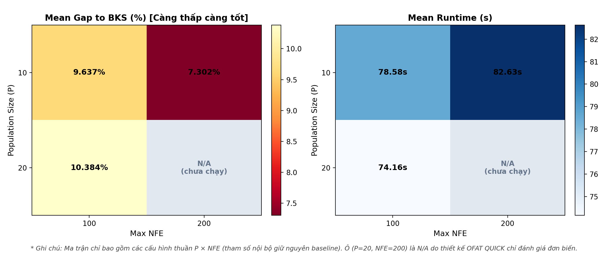
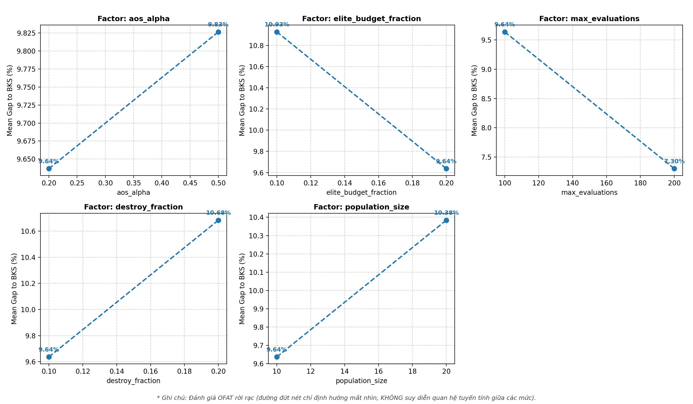
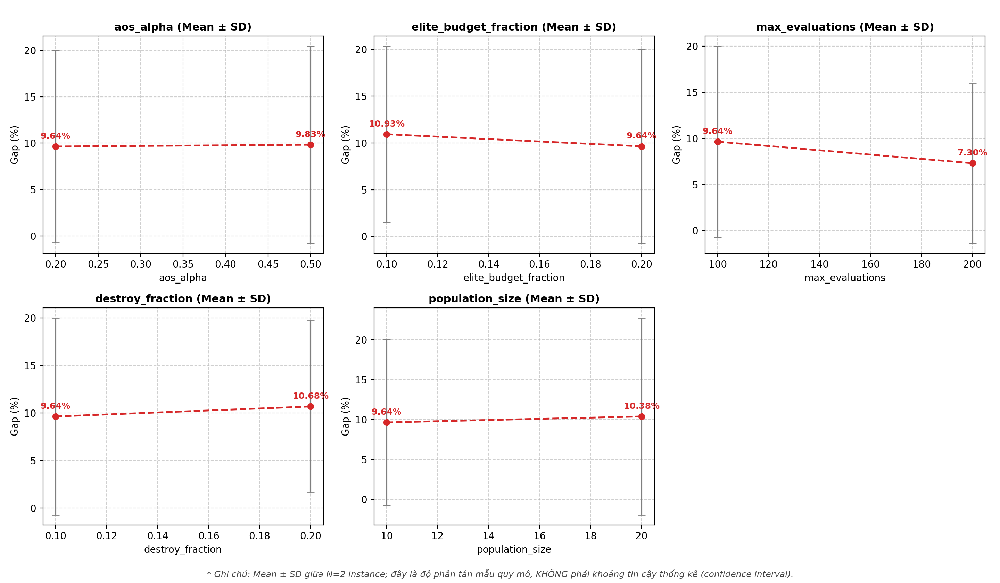
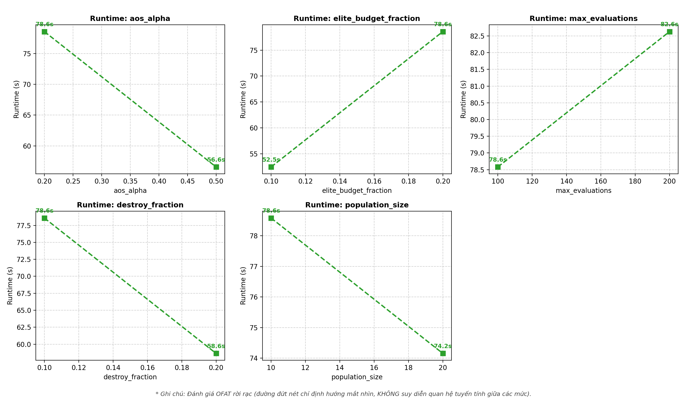
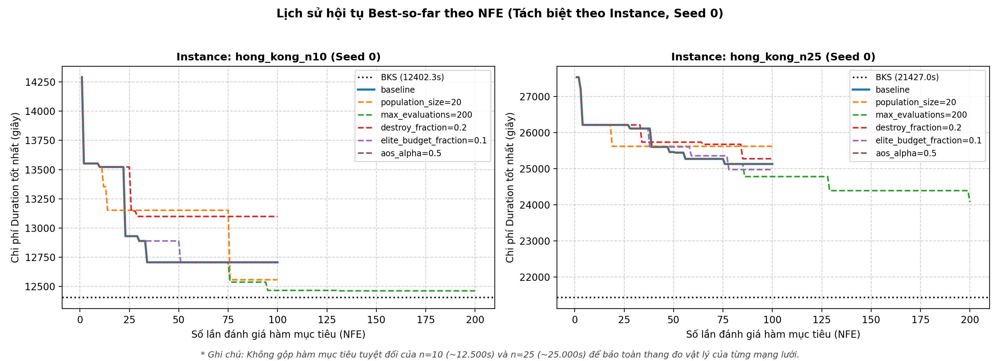

# PHÂN TÍCH ĐỘ NHẠY THAM SỐ CỦA THUẬT TOÁN RAPO-2709

## 1. Mục tiêu thực nghiệm

Phân tích độ nhạy tham số được thực hiện nhằm khảo sát mức độ ảnh hưởng của các tham số điều khiển đến chất lượng nghiệm và chi phí tính toán của thuật toán RAPO-2709 khi giải bài toán định tuyến phương tiện phụ thuộc thời gian (Time-Dependent Vehicle Routing Problem, TDVRP).

Nghiên cứu sử dụng phương pháp thay đổi một yếu tố tại một thời điểm (One-Factor-at-a-Time, OFAT). Theo đó, tại mỗi cấu hình khảo sát, chỉ một tham số được điều chỉnh so với cấu hình tham chiếu; các tham số còn lại được giữ cố định.

Thực nghiệm tập trung vào năm yếu tố: kích thước quần thể, ngân sách đánh giá hàm mục tiêu, tỷ lệ phá hủy trong POA, tỷ lệ ngân sách dành cho Elite và hệ số học của Adaptive Operator Selection (AOS).

Đây là thực nghiệm thăm dò với phạm vi dữ liệu thu hẹp, không phải thí nghiệm xác nhận cấu hình tối ưu tổng quát.

## 2. Thiết kế thực nghiệm

### 2.1. Bộ dữ liệu và điều kiện thực nghiệm

Thực nghiệm sử dụng hai instance thuộc bộ dữ liệu Poryos2026, tương ứng với hai quy mô:

- `hong_kong_n10_hyb_bpr_moderate`: 10 khách hàng.
- `hong_kong_n25_hyb_bpr_moderate`: 25 khách hàng.

Cả hai instance đều sử dụng mạng giao thông Hong Kong, phương pháp lấy mẫu hyb và kịch bản BPR-moderate.

Mỗi cấu hình được thực hiện với hai hạt giống ngẫu nhiên độc lập (seed 0 và seed 1). Tổng số lượt chạy là:

\[
N_{\mathrm{runs}}=6\times2\times2=24.
\]

Tất cả 24 lượt chạy được ghi nhận hoàn thành và tạo nghiệm khả thi trong kết quả thực nghiệm.

### 2.2. Các tham số khảo sát

Cấu hình tham chiếu gồm:

| Tham số | Giá trị |
|---|---:|
| Population size (P) | 10 |
| Max NFE | 100 |
| POA destroy fraction | 0,10 |
| Elite budget fraction | 0,20 |
| AOS learning rate (alpha) | 0,20 |
| AOS probability floor (epsilon) | 0,10 |

Năm biến thể OFAT được xây dựng bằng cách lần lượt thay đổi:

1. Population từ 10 lên 20.
2. Max NFE từ 100 lên 200.
3. POA destroy fraction từ 0,10 lên 0,20.
4. Elite budget fraction từ 0,20 xuống 0,10.
5. AOS alpha từ 0,20 lên 0,50.

Các biến thể đều giữ nguyên những tham số không thuộc yếu tố đang được khảo sát.

### 2.3. Các chỉ số đánh giá

Chất lượng nghiệm được đánh giá bằng Gap so với giá trị tham chiếu BKS:

\[
\mathrm{Gap}(\%) =
\frac{f_{\mathrm{RAPO}}-f_{\mathrm{BKS}}}
{f_{\mathrm{BKS}}}\times100.
\]

Trong đó, \(f_{\mathrm{RAPO}}\) là chi phí Duration của nghiệm thu được, còn \(f_{\mathrm{BKS}}\) là giá trị tham chiếu tương ứng với từng instance.

Gap càng thấp thể hiện chất lượng nghiệm càng tốt.

Bên cạnh đó, thời gian thực thi (Runtime) được sử dụng để xem xét chi phí tính toán. Giá trị Gap được tổng hợp qua hai cấp: trước hết lấy trung bình giữa các seed của từng instance, sau đó lấy trung bình không trọng số giữa các instance.

Độ lệch chuẩn giữa các instance được trình bày riêng, không đồng nhất với độ lệch chuẩn giữa các seed.

## 3. Kết quả tổng hợp

Bảng 1 trình bày Mean Gap và Runtime trung bình của sáu cấu hình.

**Bảng 1. Kết quả khảo sát độ nhạy tham số RAPO-2709**

| Cấu hình | Mean Gap (%) | Δ Gap (điểm %) | Runtime (s) | Δ Runtime (s) |
|---|---:|---:|---:|---:|
| Baseline | 9,637 | 0,000 | 78,58 | 0,00 |
| P = 20 | 10,384 | +0,747 | 74,16 | -4,42 |
| NFE = 200 | **7,302** | **-2,335** | 82,63 | +4,05 |
| Destroy fraction = 0,20 | 10,683 | +1,046 | 58,65 | -19,93 |
| Elite budget fraction = 0,10 | 10,927 | +1,290 | 52,46 | -26,12 |
| AOS alpha = 0,50 | 9,826 | +0,190 | 56,57 | -22,01 |

*Ghi chú: Δ được tính bằng giá trị của cấu hình khảo sát trừ giá trị Baseline. Giá trị Δ Gap âm biểu thị sự cải thiện chất lượng nghiệm.*

Trong phạm vi sáu cấu hình đã thử, cấu hình NFE=200 đạt Mean Gap thấp nhất. So với Baseline, Mean Gap giảm 2,335 điểm phần trăm, tương ứng mức giảm tương đối khoảng 24,2%.

Runtime trung bình tăng từ 78,58 lên 82,63 giây, tương ứng khoảng 5,2%.

Kết quả này cho thấy việc tăng ngân sách tìm kiếm có tiềm năng cải thiện chất lượng nghiệm trong phạm vi khảo sát.

Tuy nhiên, thay đổi Max NFE cũng có thể tác động đến ngân sách phân bổ cho các nhánh tìm kiếm, đặc biệt khi hạn ngạch Elite được xác định theo tỷ lệ của ngân sách đánh giá. Vì vậy, không thể quy toàn bộ cải thiện cho riêng số lần đánh giá bổ sung.

## 4. Phân tích ảnh hưởng của Population và NFE

*Hình 1. Mean Gap và Runtime trung bình theo Population và Max NFE. Chỉ những cấu hình giữ nguyên các tham số nội bộ của Baseline mới được đưa vào ma trận. Ô P=20, NFE=200 chưa được thực nghiệm và được đánh dấu N/A.*

Tại P=10, tăng NFE từ 100 lên 200 làm Mean Gap giảm từ 9,637% xuống 7,302%.

Ngược lại, tại NFE=100, tăng Population từ 10 lên 20 làm Mean Gap tăng từ 9,637% lên 10,384%.

Điều này cho thấy tăng quy mô quần thể không nhất thiết cải thiện chất lượng nghiệm khi ngân sách NFE được giữ cố định. Một phần ngân sách được sử dụng cho quá trình khởi tạo quần thể, do đó việc tăng P có thể làm giảm ngân sách còn lại cho hoạt động tìm kiếm sau khởi tạo.

Do ô P=20, NFE=200 chưa được thực nghiệm, dữ liệu hiện tại không đủ để đánh giá tác động tương tác giữa P và NFE. Ma trận trong Hình 1 là ma trận khảo sát không đầy đủ theo thiết kế OFAT, không phải thiết kế nhân tố đầy đủ.

## 5. Phân tích độ nhạy của các tham số điều khiển

*Hình 2. Sự thay đổi Mean Gap khi điều chỉnh riêng lẻ từng tham số theo phương pháp OFAT. Đường nét đứt nối các mức khảo sát mang tính hướng dẫn trực quan, không thể hiện quan hệ tuyến tính liên tục.*

### 5.1. Kích thước quần thể

Khi tăng Population từ 10 lên 20, Mean Gap tổng hợp tăng 0,747 điểm phần trăm.

Tuy nhiên, tác động không đồng nhất giữa hai quy mô bài toán. Trên n=10, Mean Gap giảm từ 2,302% xuống 1,651%. Trên n=25, Mean Gap tăng từ 16,972% lên 19,116%.

Điều này gợi ý rằng tác động của Population có thể phụ thuộc vào độ phức tạp và đặc điểm của instance, cũng như cách ngân sách đánh giá được phân bổ giữa khởi tạo và tìm kiếm.

### 5.2. Tỷ lệ phá hủy POA

Khi tăng destroy fraction từ 0,10 lên 0,20, Mean Gap tăng từ 9,637% lên 10,683%, tương ứng chênh lệch +1,046 điểm phần trăm.

Trong phạm vi hai instance được khảo sát, việc tăng cường độ phá hủy không cải thiện chất lượng nghiệm trung bình. Một khả năng giải thích là thay đổi mạnh cấu trúc hoán vị có thể làm gián đoạn các thành phần tốt của nghiệm hiện tại. Tuy nhiên, dữ liệu hiện có chưa đủ để xác nhận cơ chế nguyên nhân này.

### 5.3. Ngân sách Elite

Khi giảm elite budget fraction từ 0,20 xuống 0,10, Mean Gap tăng từ 9,637% lên 10,927%, trong khi Runtime giảm từ 78,58 xuống 52,46 giây.

Kết quả gợi ý một sự đánh đổi giữa chất lượng nghiệm và chi phí tính toán. Việc dành ít ngân sách hơn cho Elite có thể giảm chi phí xử lý, nhưng trong mẫu khảo sát này đi kèm với chất lượng nghiệm trung bình thấp hơn.

### 5.4. Hệ số học AOS

Khi tăng alpha từ 0,20 lên 0,50, Mean Gap tăng nhẹ từ 9,637% lên 9,826%, tương ứng +0,190 điểm phần trăm.

Đây là mức chênh lệch Mean Gap nhỏ nhất trong các thay đổi được khảo sát. Vì vậy, chưa thấy bằng chứng mô tả mạnh về lợi ích chất lượng nghiệm khi tăng alpha lên 0,50 trong điều kiện QUICK.

Tuy nhiên, hai mức alpha và bốn lượt chạy cho mỗi cấu hình chưa đủ để kết luận thuật toán ít nhạy với alpha trong mọi điều kiện.

## 6. Phân tích sự khác biệt giữa hai quy mô

**Bảng 2. Mean Gap theo quy mô bài toán**

| Cấu hình | n=10 (%) | n=25 (%) |
|---|---:|---:|
| Baseline | 2,302 | 16,972 |
| P = 20 | 1,651 | 19,116 |
| NFE = 200 | **1,155** | **13,450** |
| Destroy fraction = 0,20 | 4,256 | 17,111 |
| Elite budget fraction = 0,10 | 4,265 | 17,589 |
| AOS alpha = 0,50 | 2,302 | 17,351 |

Kết quả cho thấy Gap trên instance n=25 cao hơn rõ rệt so với n=10 ở tất cả cấu hình khảo sát.

Đối với NFE=200, mức giảm Gap so với Baseline là 1,147 điểm phần trăm trên n=10 và 3,522 điểm phần trăm trên n=25.

Tuy nhiên, mỗi nhóm quy mô chỉ có một instance. Vì vậy, khác biệt giữa n=10 và n=25 không thể được xem là bằng chứng xác nhận rằng quy mô bài toán là nguyên nhân duy nhất gây ra sự khác biệt về Gap.

## 7. Độ phân tán kết quả giữa các instance

*Hình 3. Mean Gap ± độ lệch chuẩn giữa hai instance n=10 và n=25. Thanh sai số thể hiện sự phân tán giữa các instance, không phải khoảng tin cậy thống kê.*

Các thanh sai số tương đối lớn phản ánh sự khác biệt đáng kể giữa hai instance có quy mô khác nhau.

Do chỉ có hai instance, độ lệch chuẩn giữa các instance rất nhạy với sự khác biệt của từng bài toán. Những phần thanh sai số kéo xuống dưới 0 không đồng nghĩa với việc có nghiệm thực tế đạt Gap âm; chúng chỉ là kết quả biểu diễn trung bình cộng hoặc trừ một độ lệch chuẩn.

Vì vậy, cần kết hợp Hình 3 với Bảng 2 để tránh diễn giải sai độ ổn định của thuật toán.

## 8. Ảnh hưởng đến thời gian thực thi

*Hình 4. Runtime trung bình khi điều chỉnh một tham số tại một thời điểm. Các mức được nối bằng đường nét đứt nhằm hỗ trợ so sánh trực quan, không nhằm suy diễn tuyến tính.*

Runtime của cấu hình NFE=200 tăng khoảng 4,05 giây so với Baseline.

Các biến thể giảm tỷ lệ ngân sách Elite, tăng destroy fraction và tăng alpha ghi nhận Runtime trung bình thấp hơn Baseline trong tập mẫu.

Trong đó, cấu hình Elite fraction=0,10 có Runtime thấp nhất, khoảng 52,46 giây, nhưng Mean Gap cao nhất trong sáu cấu hình, khoảng 10,927%.

Những khác biệt Runtime cần được diễn giải thận trọng vì có thể chịu ảnh hưởng của tải hệ thống, thực thi song song và các yếu tố môi trường. Kết quả mô tả không đủ để khẳng định quan hệ nhân quả giữa một thay đổi tham số và tốc độ thực thi.

## 9. Phân tích lịch sử hội tụ

*Hình 5. Lịch sử hội tụ Best-so-far theo NFE trên hai instance Hong Kong n=10 và n=25, tại seed 0. Hai đồ thị được tách riêng để bảo toàn thang đo chi phí Duration. Đường chấm màu đen biểu diễn BKS.*

Các đường hội tụ có dạng bậc thang không tăng, phù hợp với cơ chế ghi nhận nghiệm tốt nhất tìm được tại từng thời điểm đánh giá.

Trên instance n=10, cấu hình NFE=200 đạt nghiệm tốt hơn Baseline trong quá trình tìm kiếm và tiếp tục duy trì giá trị nghiệm tốt nhất sau mốc 100 NFE.

Trên instance n=25, đường hội tụ của cấu hình NFE=200 tiếp tục có những bước cải thiện sau mốc 100, cho thấy ngân sách bổ sung có thể hữu ích trong quá trình tìm kiếm.

Các đường trong Hình 5 chỉ biểu diễn seed 0 và không phải đường hội tụ trung bình của toàn bộ các seed. Vì vậy, chúng được sử dụng để minh họa diễn tiến tìm kiếm, trong khi kết luận về chất lượng nghiệm trung bình phải dựa trên các bảng tổng hợp.

## 10. Giới hạn thực nghiệm và ý nghĩa thống kê

Thực nghiệm QUICK có các giới hạn cần ghi nhận.

Thứ nhất, tập dữ liệu chỉ gồm hai instance thuộc cùng mạng Hong Kong. Kết quả chưa phản ánh đầy đủ sự đa dạng về thành phố, cấu trúc mạng giao thông và cách lấy mẫu của Poryos2026.

Thứ hai, mỗi cấu hình chỉ được chạy với hai seed, nên khả năng đánh giá độ ổn định ngẫu nhiên còn hạn chế.

Thứ ba, mỗi tham số chỉ được khảo sát tại hai mức. Do đó, nghiên cứu chưa xác định được hình dạng quan hệ giữa tham số và chất lượng nghiệm, cũng như chưa xác định được giá trị tối ưu tổng quát.

Thứ tư, thiết kế OFAT không đánh giá đầy đủ tương tác giữa các tham số.

Các kết quả kiểm định ghép cặp trong báo cáo hiện tại không đạt ngưỡng ý nghĩa thống kê 0,05. Với chỉ hai cặp instance, kiểm định Wilcoxon Signed-Rank không có đủ độ phân giải để đưa ra kết luận xác nhận mạnh. Việc không đạt ý nghĩa thống kê không đồng nghĩa với việc các cấu hình có hiệu quả bằng nhau.

Cuối cùng, kết quả được thực hiện với RAPO-2709. Không tự động chuyển các kết luận này sang RAPO-ACX hoặc phiên bản RAPO khác nếu cơ chế thuật toán không tương đồng.

## 11. Kết luận

Thực nghiệm khảo sát độ nhạy tham số trên hai instance nhỏ và vừa của Poryos2026 cho thấy ngân sách đánh giá NFE là yếu tố tạo ra mức cải thiện Mean Gap lớn nhất trong các thay đổi đã thử.

Tăng Max NFE từ 100 lên 200 giúp Mean Gap tổng hợp giảm từ 9,637% xuống 7,302%, với mức tăng Runtime trung bình tương đối nhỏ trong tập kết quả hiện có.

Các thay đổi đối với Population, tỷ lệ phá hủy POA, ngân sách Elite và hệ số học AOS tạo ra những kết quả khác nhau về chất lượng nghiệm và thời gian thực thi. Đặc biệt, giảm ngân sách Elite làm giảm Runtime nhưng đi kèm với Mean Gap tăng trong mẫu khảo sát.

Nhìn chung, kết quả QUICK cung cấp cơ sở thăm dò ban đầu cho việc lựa chọn tham số và nhận diện sự đánh đổi giữa chất lượng nghiệm và chi phí tính toán. Tuy nhiên, do giới hạn về số instance, seed và mức tham số, chưa thể kết luận cấu hình tối ưu tổng quát của RAPO-2709.

## Phụ lục. Nguồn dữ liệu và khả năng tái lập

Thực nghiệm được tổng hợp từ các tệp kết quả thực tế trong `results/sensitivity/rapo/quick/`.

Các tệp dữ liệu kèm theo:

- `data/raw_results.csv`: dữ liệu gốc của 24 lượt chạy.
- `data/all_runs.csv`: dữ liệu lượt chạy sau khi tổng hợp.
- `data/summary_by_parameter.csv`: thống kê theo tham số.
- `data/summary_by_instance.csv`: thống kê theo instance.
- `data/summary_by_size.csv`: thống kê theo quy mô.
- `data/baseline_comparisons.csv`: so sánh ghép cặp với Baseline.
- `data/manifest.json`: thông tin thực nghiệm và cấu hình.
- `data/sensitivity_report.md`: báo cáo được hệ thống phân tích sinh ra.

Các hình ảnh được tham chiếu bằng đường dẫn tương đối trong thư mục `figures/` để bảo đảm tài liệu có thể được di chuyển hoặc giải nén trên máy khác.

**Lưu ý:** Báo cáo này trình bày các kết quả độ nhạy sơ bộ của RAPO-2709, không phải kết quả đối sánh chính thức hoặc minh chứng tối ưu tham số của tất cả phiên bản RAPO.